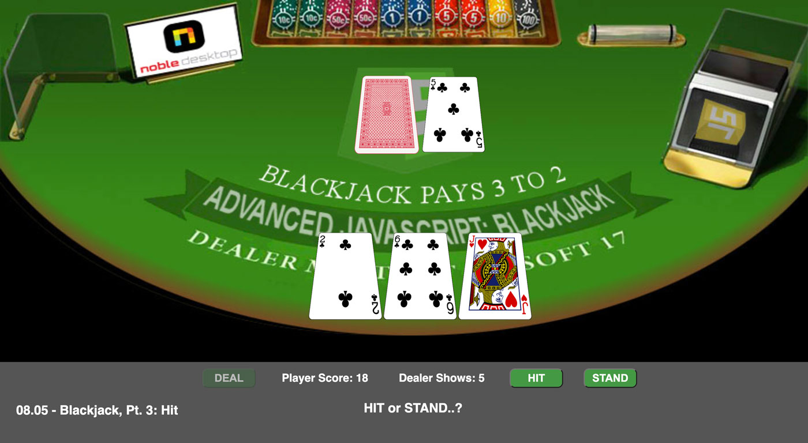

<!-- # Lesson 08.05  -->

<p align="center">


<br>

</p>

### Blackjack - Pt. 3: Hit

### implementing the HIT button functionality

### evaluating Ace value as either 11 or 1

The next thing we need to do for our Blackjack application is handle what happens when the player clicks the HIT button to get another card.

1. We already have the hit button, so give it a listener that calls the **hit()** function when clicked. "Old step 12" is where you add this line:

```
    const dealBtn = document.getElementById('deal-btn');
    dealBtn.addEventListener('click', deal);

    const hitBtn = document.getElementById('hit-btn');
    hitBtn.addEventListener('click', hit);
```

**HIT ME!**

**the HIT button calls the hit() function**

2. Down at the bottom of the code, after the **showHoleCard()** function, define the **hit()** function:

```
    function hit() {

    }
```

3.  Pop a card off the shoe, and pass it to a local **card** object:

```
    function hit() {
        let card = shoe.pop();
    }
```

4. The hit card needs to go on the table, so declare a new image object:

```
        let pic = new Image();
```

5.  Set the image source to the **file** property of the **card** object:

```
        pic.src = `images/cards350px/${card.file}`;
```

6. Output the pic to the "table" (the player cards div). At this point, you should also run the app to test if the hit card is appearing on the table.

```
        playerCardsDiv.appendChild(pic);
```

**handling the "Hit Ace" scenario**  
We next need to add the hit card to the score. Once again, Aces pose a challenge. Here, an Ace counts as 11 only if it won't bust the player. If an "Ace 11" would put the player over 21, the Ace counts as 1.

7. Check if the Hit card is an Ace:

```
        if(card.kind == "Ace") {
        }
```

If the hit card is an Ace, we need to check to see if an "Ace 11" would bust the player. If so, the Ace counts as 1.

8. Check if the player score is less than 11; if it is, increase **pAceScore** and **playerScore** by 11:

```
        if(card.kind == "Ace") {
            if(playerScore < 11) {
                playerScore += 11;
                pAceScore += 11;
            }
        }
```

9. **else** the player score was at least 11 _before_ the hit, so the "Hit Ace" value is 1. Increment **pAceScore** and **playerScore** by 1:

```
        if(card.kind == "Ace") {
            if(playerScore < 11) {
                playerScore += 11; // Ace counts as 11
                pAceScore += 11;
            } else {
                playerScore++; // Ace counts as 1
                pAceScore++;
            }
        }
```

**handling existing "Ace 11" scenario**  
The **"Hit Ace"** scenario has been handled, but what if the hit card is _not_ an Ace, but the player nevertheless has an "Ace 11" from the Deal or a prior Hit? In this case, if the hit card would bust the dealer, the existing "Ace 11" must be downgraded to a 1.

10. Check if the hit card has busted the player. This will only be possible if the hit card is not an Ace. This code comes right after the above if-statement:

```
            if(playerScore > 21) {
            }
```

If the player's score is over 21, they bust. But if they have an "Ace 11", it can be changed to an Ace 1, which will "un-bust" them.

11. If the player's score is over 21 (busted), see if the player has an "Ace 11" to "bail them out":

```
            if(playerScore > 21) {
                if(pAceScore >= 11) {
                }
            }
```

If the **pAceScore** is at least 11, the player has an "Ace 11", which can be downgraded to an Ace 1, which "un-busts" the player:

12. Inside the inner if, "un-bust" the player by converting their "Ace 11" to a 1. This is done by subtracting 10 from both the **playerScore** and the **pAceScore**:

```
            if(playerScore > 21) {
                if(pAceScore >= 11) {
                    pAceScore -= 10;
                    playerScore -= 10;
                }
            }
```

**Busted!**  
If the player score exceeds 21 and if the player has no "Ace 11" to "bail them out", they are busted.

13. Add an inner **else** part to announce that the player is busted:

```
            if(playerScore > 21) {
                if(pAceScore >= 11) {
                    pAceScore -= 10;
                    playerScore -= 10;
                } else {
                    outputH2.innerHTML = "Busted! You lose!";
                }
            }
```

**Exactly 21**  
If the player's score is exactly 21, the **stand()** function is called automatically, which ends the player's turn and moves on to assessing the dealer's hand.

14. Add an **else-if** to the outer if block that handles a score of exactly 21 following a hit. Include a call to the **stand()** function, which we will write next:

```
            if(playerScore > 21) {
                if(pAceScore >= 11) {
                    pAceScore -= 10;
                    playerScore -= 10;
                } else {
                    outputH2.innerHTML = "Busted! You lose!";
                }
            } else if(playerScore == 21) {
                outputH2.innerHTML = "You have 21! Dealer's turn.";
                stand();
            }
```

**After Hit, Player still has less than 21**  
If, after hitting, the player still has less than 21, they are prompted again to "HIT or STAND..?"

15. Add an **else** to the that handles what to do if the player still has less than 21 after having hit:

```
            } else if(playerScore == 21) {
                outputH2.innerHTML = "You have 21! Dealer's turn.";
            } else {
                outputH2.innerHTML = "HIT or STAND..?";
            }
```

16. In the nested if, where the dealer has "un-busted", handle a player score of 21 or less than 21:

```
        if(playerScore > 21) {
            if(pAceScore >= 11) {
                pAceScore -= 10;
                playerScore -= 10;

                if(playerScore == 21) {
                    outputH2.innerHTML = "You have 21! Dealer's turn.";
                } else { // player score is less than 21
                    outputH2.innerHTML = "HIT or STAND..?";
                }

            } else {
```

17. Below the big, nested if-else if-else, update the player's score display:

```
            } else {
                outputH2.innerHTML = "HIT or STAND..?";
            }

            playerScoreDiv.innerHTML = "Player Score: " + playerScore;
```

**stand() function**  
The **stand()** function is called when the user clicks the STAND button. If is also called automatically if a Hit achieves a player score of exactly 21.

18. Up in the code where all the buttons are brought in, instruct the STAND button to to listen for a click upon itself and to call the **stand** function when that click occurs:

```
    const standBtn = document.getElementById('stand-btn');
    standBtn.addEventListener('click', stand);
```

**minimalist stand() function for testing**
So that we can test the Hit feature fully, let's start with a minimal implementation of the **stand()** function. Rather than assess the dealer's score with all the tricky implications for Aces and so forth, we will start by just revealing the hole card, and replacing the "Dealer Shows" with the "Dealer Score".

19. Down at the bottom of the code, below the **hit()** function, define the stand function:

```
    function stand() {
    }
```

20. It's the dealer's turn to play out their hand, so reveal the hole card:

```
    function stand() {
        holeCardPic.src = `images/cards350px/${dealerHand[0].file}`;

    }
```

21. Now that the dealer's score is no longer a secret, replace "Dealer Shows" with "Dealer Score". Also mention that it's the dealer's turn now:

```
    function stand() {
        holeCardPic.src = `images/cards350px/${dealerHand[0].file}`;
        dealerScoreDiv.innerHTML = "Player Score: " + playerScore;
        outputH2.innerHTML = "Dealer's turn..";
    }
```

22. There is plenty more to do with the **stand()** function, and we also have some fine-tuning to do with activating-deactivating the buttons, but test the game now. The **hit()** and **stand()** functions should both be working, as expected.

**refactoring for smoother game play with setTimeout**  
It works, but the **stand()** function runs a bit abrupty. Better would be to spool out the action in phases. We can do this by dividing the code into **setTimeout** callback functions on staggered delays.

23. Refactor **stand()** function to execute its code on staggered delays, with **setTimeout**.

- after 500 milliseconds, we are informed that the player is standing on their score and that it is the dealer's turn now.
- after 2000 milliseconds, we suspense builds as the Hole card is.. teased but not revealed.
- After 3000 milliseconds, the hole card is revealed and the dealer's score is reported, both in the Dealer Score Div and in the output message.

```
    function stand() {

        setTimeout(() => {
            outputH2.innerHTML = "Standing on " + playerScore + ". .. Dealer's turn..";
        }, 500);

        setTimeout(() => {
            // 08.05 20. reveal the hole card:
            outputH2.innerHTML = "Hole card is.. ";
        }, 2000);


        setTimeout(() => {
            // 08.05 20. reveal the hole card:
            outputH2.innerHTML += dealerHand[0].name + " .. Dealer has " + dealerScore;
            holeCardPic.src = `images/cards350px/${dealerHand[0].file}`;
            // 21. replace "Dealer Shows" with "Dealer Score"; also say it's the dealer's turn:
            dealerScoreDiv.innerHTML = "Dealer Score: " + dealerScore;
        }, 3000);

    } // end stand() function
```

**the dealer hits automatically until reaching 17**  
The dealer must hit until reaching a score of 17 or more. The dealer must hit on "Soft 17", which is a 17 that includes an "Ace 11".

24. Still in the **stand()** function, do another **setTimeout** that checks if the dealer score is less than 17, which indicates that the dealer must hit. Do this on a 4-second delay to keep the timing smooth:

```
        setTimeout(() => {
            if(dealerScore < 17) {
            }
        }, 4000);

    } // end stand() function
```

25. For now, let's just output a message "Dealer Must Hit". We'll handle the actual hit later:

```
        setTimeout(() => {
            if(dealerScore < 17) {
                outputH2.innerHTML = "Dealer Must Hit on " + dealerScore;
            }
        }, 4000);

    } // end stand() function
```

26. As an else-if, check if the dealer score is exactly 17, and if so, if the dealer has "Soft 17", which would be indicated by a **dAceScore** of 11 or more.

- If the dealer _does_ have "Soft 17":
  - decrease **dealerScore** and **dAceScore** by 10 (downgrade "Ace 11" to 1).
  - announce that the "Dealer Must Hit on Soft 17":

```
        setTimeout(() => {
            if(dealerScore < 17) {
                outputH2.innerHTML = "Dealer Must Hit on " + dealerScore;
            } else if(dealerScore == 17) {
                if(dAceScore >= 11) {
                    dAceScore -= 10;
                    dealerScore -= 10;
                    outputH2.innerHTML = "Dealer Must Hit on Soft 17";
                }
            }
        }, 4000);

    } // end stand() function
```

27. **else if** the dealer has exactly 17 (but not "Soft 17"), so announce that the dealer must stand on 17:

```
        setTimeout(() => {
            if(dealerScore < 17) {
                outputH2.innerHTML = "Dealer Must Hit on " + dealerScore;
            } else if(dealerScore == 17) {
                if(dAceScore >= 11) {
                    dAceScore -= 10;
                    dealerScore -= 10;
                    outputH2.innerHTML = "Dealer Must Hit on Soft 17";
                } else {
                    outputH2.innerHTML = "Dealer Stands on " + dealerScore;
                }
            }
        }, 4000);

    } // end stand() function
```

28. **else** the dealer has less than 17, so announce that the dealer must hit:

```
        setTimeout(() => {
            if(dealerScore < 17) {
                outputH2.innerHTML = "Dealer Must Hit on " + dealerScore;
            } else if(dealerScore == 17) {
                if(dAceScore >= 11) {
                    dAceScore -= 10;
                    dealerScore -= 10;
                    outputH2.innerHTML = "Dealer Must Hit on Soft 17";
                } else {
                    outputH2.innerHTML = "Dealer Stands on " + dealerScore;
                }
            } else {
                outputH2.innerHTML = "Dealer Must hit on " + dealerScore;
            }
        }, 4000);

    } // end stand() function
```

29. The nested logic is getting pretty complicated, so now would be a good time to test the application--if you haven't been doing so already.

**evaluating winner**  
We haven't handled giving the dealer more cards yet, but we can still evaluate a winner in one scenario: when the dealer was dealt at least a hard 17 and therefore doesn't get any additional cards.

30. Inside the **else** part where the "Dealer Stands", call the **declareWinner()** function:

```
                } else {
                    outputH2.innerHTML = "Dealer Stands on " + dealerScore;
                    declareWinner();
                }
```

**declareWinner() function**  
The **declareWinner()** function compares the player and dealer scores and declares the winner. If the score is tied, a "Push" is declared.

31. Define the **declareWinner()** function:

```
    function declareWinner() {
    }
```

32. Inside the function, compare the two scores using if-else if-else logic. Wrap this in a **setTimeout** so that we get a 2-second delay between announcing that the "Dealer Stands" and the declaration of the winner:

```
    function declareWinner() {
        setTimeout(() => {
            if(playerScore > dealerScore) {
                outputH2.innerHTML = "You win! Congrats!";
            } else if(playerScore <> dealerScore) {
                outputH2.innerHTML = "Sorry! You lose!";
            } else { // the scores are equal
                outputH2.innerHTML = "It's a Push..!";
            }
        }, 2000);
    }
```

33. Run the app. You may have to play a few hands before you see a winner / loser declared. This is because, so far, the dealer can't hit yet, so the **declareWinner()** function only runs when the dealer must stand on the opening deal.

**the dealer hits**  
Last thing to implement is the dealer hitting automatically. We already have some of the logical foundation for this in the **stand()** function where we check if the dealer has less than 17 or 17 exactly (including "Soft 17"). Insidde these parts, we will add calls to a new function, called **hitDealer()**.

34. Call the **hitDealer()** function twice: where the dealer score is less than 17 and also on "Soft 17". The calls go right under the two "Dealer Must Hit" lines:

```
        setTimeout(() => {
            if(dealerScore < 17) {
                outputH2.innerHTML = "Dealer Must Hit on " + dealerScore;
                hitDealer();
            } else if(dealerScore == 17) {
                if(dAceScore >= 11) {
                    dAceScore -= 10;
                    dealerScore -= 10;
                    outputH2.innerHTML = "Dealer Must Hit on Soft 17";
                    hitDealer();
                } else {
                    outputH2.innerHTML = "Dealer Stands on " + dealerScore;
                }
            } else {
                outputH2.innerHTML = "Dealer Must hit on " + dealerScore;
            }
        }, 4000);

    } // end stand() function
```

**END: Lesson 08.05**  
**NEXT: Lesson 08.06**
